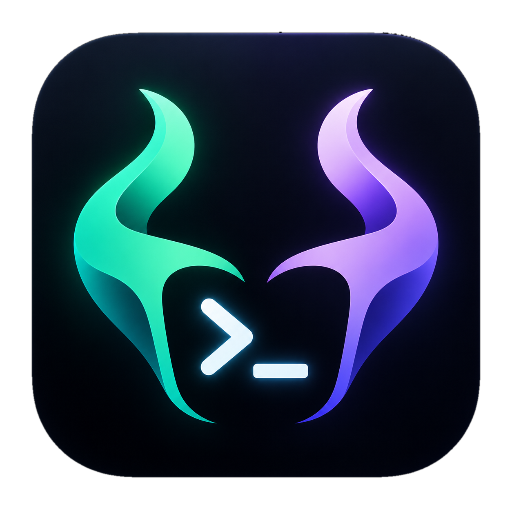

# LokiShell

**Let your shell shapeshift personas with every `cd`.**

Automatic CLI account and environment switching by directory for **zsh and bash**. Use personal and work **GitHub, Firebase, Google Cloud, Claude Code, and Codex** accounts across projects, Git worktrees, and parallel coding agents.

Choose a global persona, override it by directory, and connect each account once. Ordinary `gh`, `firebase`, `gcloud`, `claude`, and `codex` commands use the selected persona.

## Install

```sh
brew install ccosnean/tap/lokishell
```

Or use curl on **macOS or Linux** with **Python 3.11+ and direnv** already installed:

```sh
curl -fsSL https://raw.githubusercontent.com/ccosnean/lokishell/main/install.sh | sh
```

The curl installer verifies the release checksum and installs into `~/.local/bin/loki` with a private Python environment under `~/.local/share/lokishell/`. If needed, follow its printed `PATH` instruction. Rerun it to upgrade. For a custom location or pinned release, pass `--prefix PATH` or `--version X.Y.Z` using `sh -s --` after the pipe. Existing personas and logins are preserved.

Then choose your persona:

```sh
loki use personal --global
```

Open a new terminal once to load the shell hooks. Homebrew installs LokiShell and its dependencies. Install the service CLIs you use separately.

## Switch personal and work accounts by directory

```sh
cd ~/projects/side-project
loki use                                # assign the global persona: personal
loki add github --user personal-user
loki add firebase

cd ~/work/acme-api
loki use work                           # create and assign work
loki add github --user work-user
loki add firebase

firebase projects:list                  # work account
gh repo list                            # work account

cd ~/projects/side-project
firebase projects:list                  # personal account
gh repo list                            # personal account
```

Personas share saved logins across their assigned folders. New personas start empty; only enabled integrations affect the environment. The GitHub integration also selects Git authentication and commit author identity.

`loki use NAME` creates missing personas. `loki use` assigns the global persona to the current folder. `loki use NAME --global` changes the default while preserving folder and worktree overrides.

## Git worktrees and parallel coding agents

Assign a persona at the repository root. New and existing worktrees inherit it automatically, including worktrees created by agents.

```sh
cd ~/work/acme-api
loki use work
loki add codex                          # connect once for the work persona

git worktree add ../acme-api-fix -b fix/login
cd ../acme-api-fix
loki status                             # work, inherited from the repository
codex                                   # work account
```

Run another agent under your personal account in a second terminal:

```sh
cd ~/projects/side-project
loki add codex                          # connect once for the personal persona
codex                                   # personal account; work agent continues
```

Override just one worktree with `loki use personal` from its root. Outside assigned directory trees and repositories, the global persona applies.

## Check current accounts

```sh
loki who                               # persona, selection source, and tool accounts
loki who --json                        # structured results for agents
loki --profile work who                # inspect work without switching this shell
```

`who` checks installed integrations with each tool's persona settings and the current directory. Its table distinguishes signed-in accounts, saved credentials, missing CLIs, and failed checks. Internal dependencies such as `google` stay hidden. Checks run concurrently with a 10-second default timeout per command; use `--timeout SECONDS` to override it.

Account details depend on the tool: Firebase reports its selected project account, gcloud reports its active account, and GitHub checks the token's owner. Claude and Codex report their login state; ADC may have saved credentials without an account email. Saved login state does not guarantee that credentials are still valid. `who` does not sign in or switch accounts.

## Manage integrations

Bundled integrations: **GitHub/Git, Firebase CLI, gcloud, Google ADC, Claude Code, and Codex**.

| Command | Purpose |
| --- | --- |
| `loki tools list` | Installed integrations for this persona |
| `loki tools catalog` | Browse the full catalog |
| `loki add TOOL` | Enable an integration and sign in |
| `loki tools install TOOL` | Enable without signing in |
| `loki tools remove TOOL` | Disable; keep saved credentials |
| `loki tools show TOOL` | Inspect configuration and login details |
| `loki --profile work add gcloud` | Connect another persona without changing this folder |

Local integrations show their installed directory in a `Source` column. `list` and `catalog` accept `--all` to include shared dependencies, or `--json` for structured output.

For direct MCP servers already configured in a persona's client, use `loki add mcp codex SERVER` or `loki add mcp claude SERVER`.

## Agent and shell behavior

`loki status` returns JSON with the effective persona and its source. `loki tools list --json` reports its installed integrations.

Fresh zsh shells load the persona even in noninteractive agent commands. Bash commands inherit an initialized shell's environment; runners that skip startup files can load the hook explicitly:

```sh
eval "$(loki hook bash)"                # use zsh for a zsh runner
```

Launch agents from an initialized terminal. Existing desktop app accounts and hosted connections follow their app login.

## Clean up or reset

| Command | Effect |
| --- | --- |
| `loki clean` | Unlink this folder; fall back to the global persona. Keep shared logins. |
| `loki clean --global` | Clear this persona's managed logins. Keep settings and agent history. |
| `loki reset` | Erase all personas, managed credentials, history, custom integrations, assignments, and hooks in the current Loki store. Keep the executable. |

Reset requires two interactive confirmations. With shell integration loaded, it unloads the current terminal's Loki hooks immediately; other terminals unload at their next prompt or directory change. Stop running agents first. Preserved `.envrc` files may need `direnv allow` again. Local cleanup does not revoke browser sessions or provider-side grants.

## How it works

The shell hook refreshes the selected persona on startup, directory changes, and prompts. Direnv loads your project settings. Loki puts small launchers on `PATH`; when you run `firebase`, `gcloud`, `gh`, `git`, `claude`, or `codex`, the launcher applies that tool's persona settings and starts the native executable.

Configuration paths and credential overrides apply to that command and its children. For example, Firebase receives its own `XDG_CONFIG_HOME`; an unrelated command in the same terminal keeps your existing XDG configuration. Python and Node SDK scripts keep their existing credentials unless you explicitly enable **`adc`**, which selects the persona's `GOOGLE_APPLICATION_CREDENTIALS` for the shell.

For example, starting with a new `work` persona:

```sh
cd ~/work/acme-api
loki use work
loki add gcloud
gcloud config set project acme-dev
```

Loki's store defaults to `~/.config/lokishell/`; `LOKI_HOME` can override it. After this example, its main files are:

```text
~/.config/lokishell/
  settings.json                 # global persona, folder/worktree assignments, shell setup
  bin/gcloud                    # launcher; the installed Google CLI stays in place
  profiles/work/
    profile.json                # enabled integrations and their settings
    env.sh                      # generates this persona's environment exports
    gcloud/                     # Google CLI credentials, configuration, and logs
      configurations/config_default

~/work/acme-api/.envrc          # marked pointer to the shared work persona
```

| Command | What changes |
| --- | --- |
| `loki use work` | Creates the persona, records the folder assignment, and adds a marked block to the project's `.envrc`, preserving existing content and file permissions. |
| `loki add gcloud` | Enables the integration in `profile.json`, creates its launcher, and runs Google's login with `CLOUDSDK_CONFIG` pointing to `profiles/work/gcloud/`. Login saves credentials and account settings there. |
| `gcloud config set project acme-dev` | Writes the project setting into that persona's active gcloud configuration. Other folders using `work` share it. |
| `cd ~/projects/side-project` | Refreshes the shell environment for that folder's persona; it does not copy credentials between folders. |

`loki use` also installs marked startup blocks in `.zshenv`/`.zshrc` or `.bashrc`/`.bash_profile`; `--no-shell` skips this. Existing settings, permissions, and direnv hooks remain. Other integrations use paths such as `codex/` and `claude/` inside the persona. Removing an integration restores native command behavior; reset removes the launchers and only Loki's marked blocks. Direnv still controls project environment approval.

Use commands through the initialized shell's `PATH`. Absolute executable paths, aliases or functions that bypass the launchers, and independently launched desktop apps use their own configuration. Child processes inherit the settings of the CLI that launched them. Custom integrations can explicitly declare shell-wide variables; inspect their definitions before installing.

Personas share your OS user's permissions. Credentials use native stores or private local files; LokiShell does not encrypt those files. See each [integration's documentation](tools/) for supported login modes and cleanup limits.

## Add an integration

```sh
loki tools install --from ./my-tool
```

A tool directory contains `tool.toml` and, when needed, `adapter.py`. See [CONTRIBUTING.md](CONTRIBUTING.md) for the schema and tests.
